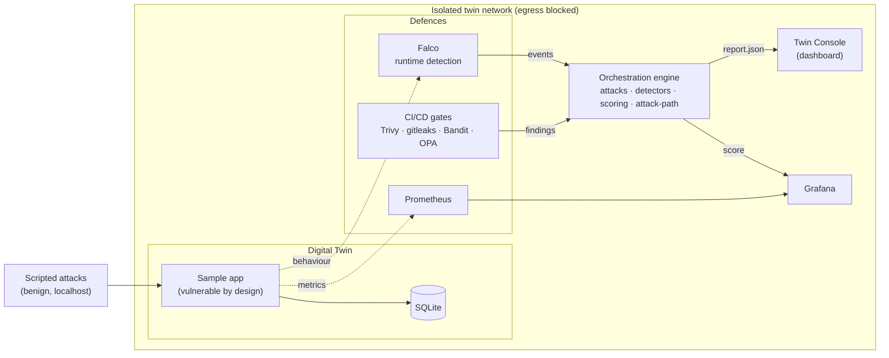

# Architecture — DevSecOps Digital Twin

## Concept

A **digital twin** is a safe, instrumented replica of a target application *and its
delivery pipeline*. Attacks are run against the twin — never production — so a team
can observe exactly how an attack propagates and whether their defences catch it.

Three defensive stages are instrumented, which is the core idea the twin proves:

| Stage | When | Tools | Catches |
|---|---|---|---|
| **Shift-left (pipeline)** | build / CI | Trivy, gitleaks, Bandit, OPA | vulnerable deps, secrets, injectable code, misconfig |
| **Runtime** | while running | Falco, Prometheus | live attack behaviour |
| **Gap** | — | — | what nothing caught (the finding that matters) |

## System diagram

## Components

- **`app/`** — the twin target: a small Flask service seeded with four weaknesses
  (SQLi, hardcoded secret, vulnerable dependency, debug misconfiguration).
- **`scenarios/`** — scenario-as-code (YAML): each declares its probe, MITRE mapping,
  natural detection stage, and remediation. Deterministic and replayable.
- **`engine/`** — the brain:
  - `attacks.py` runs benign localhost probes,
  - `detectors.py` normalises Trivy/gitleaks/Falco findings,
  - `scoring.py` computes the weighted posture score,
  - `attack_path.py` builds the MITRE-mapped kill-chain graph,
  - `orchestrator.py` ties it together into `report.json`,
  - `report.py` emits the security report, `api.py` serves the console.
- **`.github/workflows/ci.yml`** — the pipeline. Toggling the gates ON is what moves
  the score from F to A.
- **`monitoring/`** — Prometheus scrape, Falco rules, Grafana dashboard.
- **`dashboard/`** — the Twin Console: animated score, attack-path graph, coverage matrix.

## Data flow (one run)

1. `orchestrator` loads scenarios → runs probes against the twin.
2. Correlates each result with pipeline + runtime detections → assigns a stage.
3. Scores baseline, builds the attack graph, applies remediations → scores hardened.
4. Writes `report.json` → dashboard + Grafana + security report read from it.

## Isolation guarantees

- Compose network can be set `internal: true` for a full air-gap.
- A Falco rule (`Twin Unexpected Egress`) fires CRITICAL on any outbound connection
  from a `twin-*` container — isolation is monitored, not just assumed.
- Every attack probe targets `localhost` only; no external hosts are contacted.
